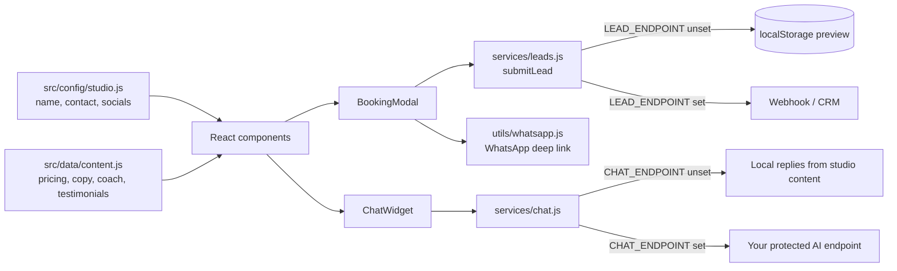

# LUMINA PILATES

**A premium one-page website template for a boutique Pilates studio, with a booking form that hands leads to WhatsApp and a bilingual chat advisor, all driven from two config files.**

**Live:** https://delevski.github.io/PilatesTemplate/

[](https://delevski.github.io/PilatesTemplate/)

## What it does

- **Studio landing page**: hero, values, experiences (private, group, functional, recovery), coach profile, memberships and pricing, testimonials, FAQ and a final CTA.
- **Booking modal** with validation (name, phone, email). A submitted request is saved as a lead and the visitor gets a ready-made **WhatsApp** message to the studio.
- **Lumina chat advisor**: a floating bilingual (English / Hebrew) assistant that answers questions about Pilates, membership pricing, general availability and choosing a session. It answers from the studio's own content and keeps medical answers to general safety information.
- **Floating actions** (WhatsApp, booking), loader, scroll reveal animations and a social-share preview image.
- All studio details, prices and testimonials in the demo are sample content.

## Architecture



Key design decisions:

- **Content as configuration.** One studio file (`src/config/studio.js`) and one content file (`src/data/content.js`) hold everything a new studio changes; components never hardcode studio data.
- **Integration boundaries with safe defaults.** `submitLead()` posts a normalized JSON record when `LEAD_ENDPOINT` is set (a non-2xx response counts as a failure) and otherwise stores it locally, so the demo works with no backend.
- **Chat that works offline first.** With no `CHAT_ENDPOINT` the advisor answers from local studio content; a real AI backend plugs in behind the same function. API keys belong on a protected server, never in the browser.
- **Swap images without touching code.** Optimized WebP files in `public/images` keep fixed filenames.
- **Tested.** Vitest + Testing Library cover the booking modal, chat widget, hero, floating actions, lead and chat services, WhatsApp links and asset paths.
- **Static deploy.** Vite builds with `base: '/PilatesTemplate/'` and a GitHub Actions workflow publishes to GitHub Pages.

## Tech stack

- **React + Vite**
- **lucide-react** icons, plain CSS
- **Vitest**, Testing Library, jsdom
- **GitHub Actions → GitHub Pages**

## Project structure

```
src/components/   Header, Hero, Values, Experience, Coach, Memberships, Testimonials,
                  Faq, FinalCta, Footer, BookingModal, ChatWidget, FloatingActions
src/config/       studio.js (studio details), chat.js (availability, chat endpoint)
src/data/         content.js (pricing, copy, coach, testimonials)
src/services/     leads.js, chat.js
src/utils/        whatsapp.js, assets.js
public/images/    WebP photography + social preview
```

## Run locally

```bash
npm install
npm run dev
```

Production check:

```bash
npm test -- --run
npm run build
```

Before launching for a real studio: fill in `src/config/studio.js` and `src/data/content.js` with approved information, and set `LEAD_ENDPOINT` / `CHAT_ENDPOINT` to your own protected endpoints if you want leads and chat to go to a server.

## Status

Complete template, deployed to GitHub Pages. Lead delivery and the AI chat backend are left as plug-in points.

## Author

**Or Delevski** · https://ordelwebsite.vercel.app
